<div align="center">

# NEXUS

### Personal Research & Knowledge Intelligence

**Turn your documents into searchable, evidence-backed answers.**

[](https://www.python.org/)
[](https://fastapi.tiangolo.com/)
[](https://react.dev/)
[](https://www.typescriptlang.org/)

*A local-first research assistant built around document ingestion, semantic retrieval, source citations, and retrieval evaluation.*

</div>

---

## What is NEXUS?

NEXUS is a research and knowledge intelligence application that turns PDF documents into a searchable knowledge base. Ask questions in natural language, retrieve relevant passages, and inspect the source material used to construct an answer.

NEXUS combines a document-processing pipeline, semantic search, an LLM-powered answer workflow, and a dashboard. Its goal is to make research easier to navigate while keeping retrieved evidence visible.

> **Design principle:** An answer should be traceable to source material. Retrieval metrics help evaluate search quality, but do not by themselves prove that a generated answer is correct.

## Capabilities

| Capability | What it does |
|---|---|
| **PDF ingestion** | Extracts text from PDF documents for processing |
| **Text processing** | Splits extracted content into retrievable chunks with metadata |
| **Semantic search** | Uses text embeddings to find meaning-related passages |
| **Evidence-backed answers** | Sends retrieved context to the configured Hermes workflow |
| **Source citations** | Makes source details and page information available alongside answers |
| **Knowledge-base management** | Supports document listing, indexing, and removal |
| **Retrieval evaluation** | Evaluates ranked search results using Recall@K and Mean Reciprocal Rank |
| **System dashboard** | Provides a UI for interacting with and monitoring the application |

## How it works




### Retrieval-augmented generation (RAG)

1. **Ingest:** Extract text from a document.
2. **Chunk:** Divide text into smaller passages and preserve relevant metadata.
3. **Embed:** Convert passages into numerical representations of their semantic content.
4. **Index:** Store vectors and associated metadata in the local index.
5. **Retrieve:** Embed a question and rank relevant passages.
6. **Generate:** Supply retrieved context to the configured Hermes workflow.
7. **Inspect:** Review the answer and the available source references.

## Technology stack

| Layer | Technology |
|---|---|
| Backend API | Python, FastAPI |
| PDF processing | PyMuPDF |
| Embeddings | Sentence Transformers |
| Embedding model | `sentence-transformers/all-MiniLM-L6-v2` |
| Vector operations | NumPy-based local index |
| LLM workflow | Hermes CLI |
| Frontend | React, TypeScript, Vite |
| Backend tests | pytest, HTTPX |
| Frontend checks | ESLint, TypeScript/Vite production build |

The embedding model and Hermes workflow serve different purposes: the embedding model supports retrieval, while Hermes is used for answer generation. They are not interchangeable.

## Retrieval evaluation

The initial small benchmark produced the following recorded results:

| Metric | Recorded result |
|---|---:|
| Evaluation questions | 8 |
| Indexed chunks in the benchmark | 5 |
| Recall@1 | 75% |
| Recall@3 | 100% |
| Recall@5 | 100% |
| Mean Reciprocal Rank (MRR) | 93.75% |
| Missing relevance labels | 0 |
| Queries with no relevant result | 0 |

**How to interpret these results**

- **Recall@K** measures whether relevant passages appear within the first K retrieved results.
- **MRR** rewards ranking a relevant passage closer to the top.
- These figures describe a small retrieval benchmark, not the factual accuracy of generated answers.
- They do not establish citation correctness, robustness across diverse documents, latency under load, or production readiness.
- A larger, independently checked evaluation set is needed before making broader performance claims.

## Project structure

```text
02-NEXUS/
├── app/                    # Python backend and RAG application
├── data/                   # Local documents, indexes, and generated data
├── docs/
│   └── assets/
│       └── nexus-rag-flow.svg
├── evaluation/              # Retrieval evaluation code and resources
├── frontend/                # React + TypeScript frontend
├── tests/                   # Backend tests
├── .gitignore
├── requirements.txt
├── README.md
└── update-release.ps1       # Local release-preparation script
```

The precise contents may evolve as the project develops. Local data and generated indexes should remain outside the public repository.

## Prerequisites

- Windows with PowerShell
- Python 3.14, matching the current development environment
- Node.js and npm
- Git
- Hermes CLI configured for the model/provider you intend to use

Python package and model compatibility can vary by platform. Use the project's tested environment when possible.

## Getting started

### 1. Clone the repository

After publishing the repository, replace the placeholder URL with your actual GitHub URL:

```powershell
git clone <YOUR_GITHUB_REPOSITORY_URL>
cd 02-NEXUS
```

If your repository uses a different directory name, enter that directory instead.

### 2. Set up the Python environment

From the project root:

```powershell
py -3.14 -m venv .venv
.\.venv\Scripts\python.exe -m pip install --upgrade pip
.\.venv\Scripts\python.exe -m pip install -r requirements.txt
```

If you already have a working project environment, avoid replacing it unnecessarily.

### 3. Configure Hermes

Install and configure Hermes according to its official instructions. Verify that the CLI is available in the terminal where you intend to run NEXUS.

NEXUS answer generation depends on the local Hermes configuration and any model/provider requirements it has. Installing the Python requirements alone does not configure an LLM provider.

### 4. Start the backend

From the project root, start the NEXUS API with:

```powershell
.\.venv\Scripts\python.exe -m uvicorn app.api:app --host 127.0.0.1 --port 8000
```

Open `http://127.0.0.1:8000/docs` to inspect the FastAPI API documentation.


### 5. Start the frontend

Open a second PowerShell terminal:

```powershell
cd .\frontend
npm ci
npm run dev
```

Open the local URL printed by Vite in the terminal.

### 6. Run backend tests and frontend checks

In a separate terminal at the project root:

```powershell
.\.venv\Scripts\python.exe -m pytest -q
```

Then check the frontend:

```powershell
cd .\frontend
npm run lint
npm run build
```

A successful production build and passing tests are useful checks, but they do not guarantee that every workflow is free of defects.

## Configuration and data handling

NEXUS processes local documents and may create local indexes, evaluation files, and benchmark output. Keep private research material and generated artifacts out of version control.

Before publishing, verify that:

- `.env` files and API credentials are excluded.
- Personal PDFs, private notes, and local datasets are excluded.
- Generated indexes, databases, and benchmark outputs are excluded unless deliberately prepared for public release.
- No API keys, access tokens, session identifiers, or personal information appear in tracked files.
- The repository does not contain private logs or machine-specific paths that should not be public.

## Security notes

NEXUS is a development project. A local API bound to `127.0.0.1` is not a substitute for a security review.

Before exposing it to other devices or the internet, review authentication, authorization, upload limits, file-path validation, PDF processing, resource consumption, error handling, and the security of the configured LLM workflow.

Do not upload confidential documents to an external model provider unless you have reviewed the provider's data-handling terms and have permission to share the material.

## Roadmap

- [ ] Add continuous integration for backend tests and frontend checks
- [ ] Expand retrieval evaluation with a larger, manually verified benchmark
- [ ] Evaluate answer factuality and citation correctness separately from retrieval
- [ ] Add reproducible clean-install and startup instructions
- [ ] Document configuration and failure recovery
- [ ] Add real screenshots of the working application
- [ ] Review security boundaries before any remote deployment
- [ ] Choose and add a project license

## Current limitations

- Retrieval results depend on the quality of extracted PDF text, chunking, embeddings, and evaluation labels.
- The initial benchmark is small and should not be treated as a general performance guarantee.
- Generated answers may be incorrect even when retrieval returns relevant passages.
- Hermes availability and answer quality depend on the configured environment and model/provider.
- Production deployment requires additional security, reliability, and performance work.

## Author

**Tuan Ahsan Aflal**  
AI/ML Engineering — building intelligent systems, retrieval pipelines, and AI-powered software.

---

<div align="center">

**NEXUS — Where research becomes searchable knowledge.**

</div>
