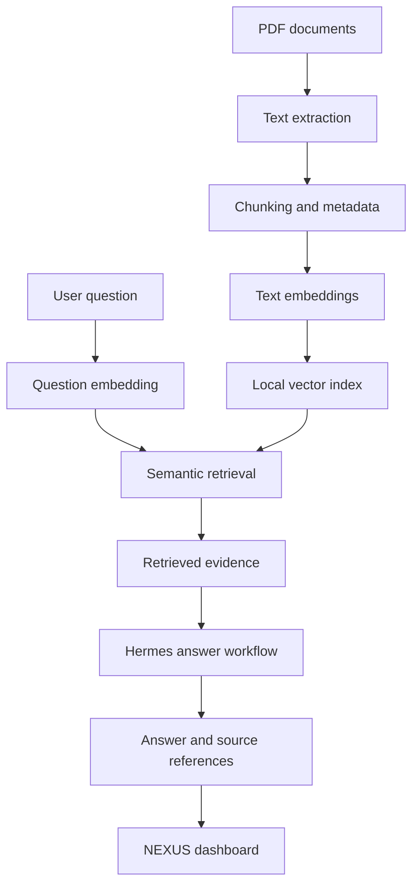

<div align="center">

# NEXUS

### Research & Knowledge Intelligence

**Turn documents into searchable, evidence-backed answers.**

A local-first research assistant built with retrieval-augmented generation (RAG), semantic search, source references, and retrieval evaluation.

<br/>

[](https://www.python.org/)
[](https://fastapi.tiangolo.com/)
[](https://react.dev/)
[](https://www.typescriptlang.org/)
[](#how-it-works)

[Overview](#overview) · [Architecture](#architecture) · [Evaluation](#retrieval-evaluation) · [Getting Started](#getting-started)

</div>

---

## Overview

Research often means searching through PDFs, revisiting technical papers, and connecting information scattered across documents. NEXUS is designed to make that process more structured and searchable.

NEXUS transforms PDF documents into a searchable knowledge base. Users can ask questions in natural language, retrieve relevant passages, and inspect the source material provided to the answer-generation workflow.

**The core principle:** answers should be traceable to evidence. Relevant search results are useful, but retrieval quality alone does not guarantee that a generated answer is correct.

## Key Capabilities

| Capability | Description |
|---|---|
| **Document ingestion** | Extract text from PDF documents for indexing |
| **Text processing** | Split extracted text into smaller passages while preserving metadata |
| **Semantic retrieval** | Find meaning-related passages using text embeddings |
| **Answer generation** | Pass retrieved context to the configured Hermes workflow |
| **Source references** | Expose available source details and page information alongside answers |
| **Knowledge-base management** | Support document listing, indexing, and removal |
| **Retrieval evaluation** | Measure ranked retrieval quality using Recall@K and Mean Reciprocal Rank |
| **Web interface** | Interact with the research system through a React and TypeScript dashboard |

## Architecture

The diagram below illustrates the document-indexing and question-answering workflows.

<div align="center">


</div>

### How it works



1. **Ingest** — extract text from source documents.
2. **Chunk** — divide the extracted text into retrievable passages.
3. **Embed** — convert passages into numerical representations of semantic content.
4. **Index** — store vectors and associated metadata in the local index.
5. **Retrieve** — find and rank passages relevant to a user's question.
6. **Generate** — provide retrieved context to the configured Hermes workflow.
7. **Inspect** — review the generated response and available source references.

### Why RAG?

Retrieval-augmented generation combines information retrieval with language-model generation. Instead of relying exclusively on information learned during model training, a RAG workflow can provide relevant passages from a document collection as context for a response.

This makes source inspection and retrieval evaluation important parts of the system. It does not eliminate hallucinations or guarantee that every answer is supported by its cited material.

## Technology Stack

| Layer | Technology |
|---|---|
| Backend | Python, FastAPI |
| PDF processing | PyMuPDF |
| Embeddings | Sentence Transformers |
| Embedding model | `sentence-transformers/all-MiniLM-L6-v2` |
| Vector operations | NumPy-based local index |
| Answer-generation workflow | Hermes CLI |
| Frontend | React, TypeScript, Vite |
| Backend testing | pytest, HTTPX |
| Frontend quality checks | ESLint, production build |

The embedding model and Hermes serve different purposes: the embedding model supports semantic retrieval, while Hermes is used for answer generation.

## Retrieval Evaluation

NEXUS includes a small retrieval benchmark to assess how effectively relevant passages appear in ranked search results.

### Recorded results

| Metric | Result |
|---|---:|
| Evaluation questions | 8 |
| Indexed chunks | 5 |
| Recall@1 | 75% |
| Recall@3 | 100% |
| Recall@5 | 100% |
| Mean Reciprocal Rank (MRR) | 93.75% |
| Missing relevance labels | 0 |
| Queries with no relevant result | 0 |

**How to interpret these numbers**

- **Recall@K** measures whether relevant passages appear within the first K results.
- **MRR** measures how highly the first relevant result is ranked.
- These results describe a small benchmark, not general performance across research collections.
- Retrieval metrics do not measure answer factuality, citation correctness, or resistance to hallucinations.
- The dataset is too small to support broad performance or production-readiness claims.

A larger, independently verified evaluation set is needed to draw stronger conclusions.

## Getting Started

### Prerequisites

- Windows with PowerShell
- Python 3.14, matching the current development environment
- Node.js and npm
- Git
- Hermes CLI configured for the intended model/provider

Package compatibility can vary across Python versions and platforms. The instructions below reflect the current development setup.

### 1. Clone the repository

```powershell
git clone https://github.com/ahsan-aflal-dev/nexus-research-intelligence.git
cd nexus-research-intelligence
```

### 2. Set up the Python environment

Run these commands from the project root:

```powershell
py -3.14 -m venv .venv
.\.venv\Scripts\python.exe -m pip install --upgrade pip
.\.venv\Scripts\python.exe -m pip install -r requirements.txt
```

If you already have a working environment, you do not need to recreate it.

### 3. Configure Hermes

Install and configure Hermes according to its official installation instructions. Ensure the CLI is available in the terminal where NEXUS will run.

Answer generation depends on the Hermes configuration and the selected model/provider. Installing the Python dependencies alone does not configure an LLM provider.

### 4. Start the backend

From the project root:

```powershell
.\.venv\Scripts\python.exe -m uvicorn app.api:app --host 127.0.0.1 --port 8000
```

The API will be available at:

- API: `http://127.0.0.1:8000`
- Interactive API documentation: `http://127.0.0.1:8000/docs`
- Health check: `http://127.0.0.1:8000/health`

Keep this terminal open while using the frontend.

### 5. Start the frontend

Open a second PowerShell terminal:

```powershell
cd frontend
npm ci
npm run dev
```

Open the local URL printed by Vite.

### 6. Run the checks

From the project root, run the backend tests:

```powershell
.\.venv\Scripts\python.exe -m pytest -q
```

Then run the frontend checks from the `frontend` directory:

```powershell
npm run lint
npm run build
```

Passing tests and producing a successful build are useful quality checks, but neither guarantees that every workflow is free of defects.

## Project Structure

```text
nexus-research-intelligence/
├── app/                 # Backend API and RAG application
├── docs/
│   └── assets/          # Architecture diagram
├── evaluation/          # Retrieval evaluation resources
├── frontend/            # React and TypeScript application
├── tests/               # Backend tests
├── .gitignore
├── requirements.txt
└── README.md
```

Local documents, generated indexes, databases, and other private artifacts are intentionally excluded from the public repository.

## Configuration & Data Handling

NEXUS can process local documents and generate local indexes, evaluation files, and benchmark output.

Before publishing changes, verify that:

- Environment files and API credentials are excluded.
- Private PDFs, notes, and datasets are not committed.
- Generated indexes and databases are excluded unless intentionally prepared for release.
- Tracked files contain no access tokens, session identifiers, or sensitive information.
- Machine-specific paths and private logs are not exposed.

## Security Considerations

NEXUS is a development project. Binding the API to `127.0.0.1` limits it to the local machine; it does not replace a security review.

Before exposing the application to other devices or the internet, assess authentication, authorization, upload limits, file-path validation, PDF processing, resource consumption, error handling, and the security of the configured LLM workflow.

Do not send confidential documents to an external model provider without reviewing its data-handling terms and confirming that you have permission to share the material.

## Roadmap

- [ ] Add continuous integration for backend and frontend checks.
- [ ] Expand retrieval evaluation using a larger, manually verified benchmark.
- [ ] Evaluate answer factuality and citation correctness separately from retrieval.
- [ ] Improve clean-install documentation and configuration guidance.
- [ ] Add genuine screenshots of the running application.
- [ ] Test failure recovery and document operational limitations.
- [ ] Review security boundaries before remote deployment.
- [ ] Select and add an appropriate open-source license.

## Current Limitations

- Retrieval quality depends on PDF text extraction, chunking, embeddings, and relevance labels.
- The current benchmark is small and does not establish general retrieval performance.
- Generated answers may be incorrect even when relevant passages are retrieved.
- Answer quality depends on the configured Hermes environment and model/provider.
- Production use would require additional security, reliability, and performance testing.

## Author

**Tuan Ahsan Aflal**  
AI/ML Engineering — building intelligent systems, retrieval pipelines, and AI-powered software.

<div align="center">

---

**NEXUS — Where research becomes searchable knowledge.**

</div>
